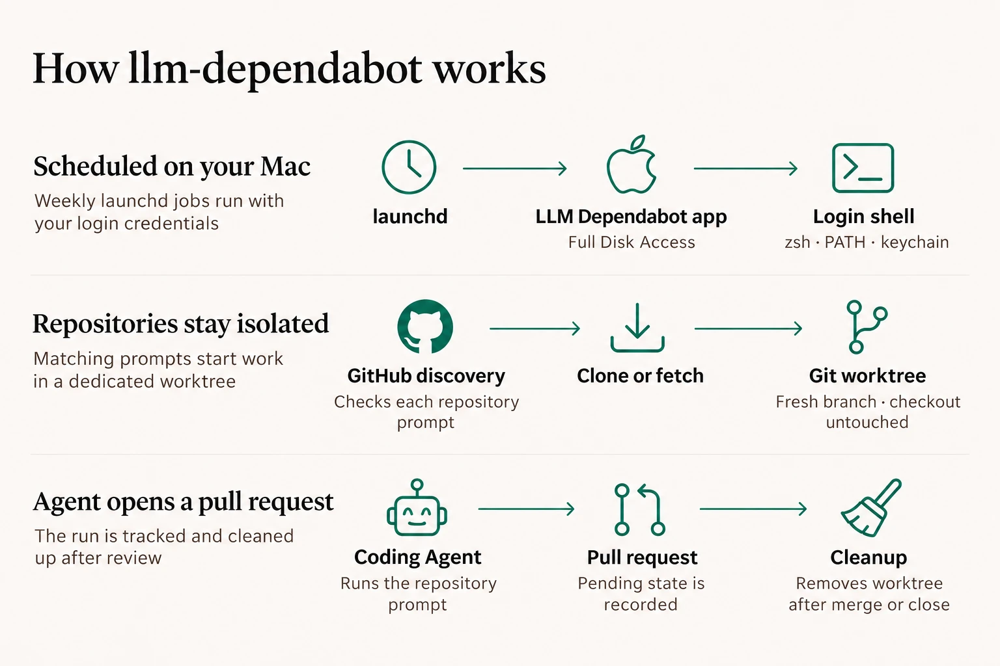

# llm-dependabot 

Dependabot, but an LLM agent does the updating.

Once a week, on your own Mac, llm-dependabot runs each repository's
dependency-update prompt with [Antigravity CLI](https://antigravity.google)
(`agy`) in YOLO mode, and the agent opens a pull request with the updates.
Unlike Dependabot, it can follow a project's own conventions, fix the breakage
an upgrade causes, and batch related bumps into one reviewable change.

- **Opt in per repository:** any repository with
  `.github/prompts/update-deps.md` takes part, and the prompt runs verbatim.

- **Staggered by ecosystem:** R on Monday, other repositories on Tuesday,
  Python on Wednesday, and web projects on Thursday.

- **Local only:** `launchd` starts the jobs, and `agy`, `gh`, and `git` use
  the credentials already on the Mac. There is no CI and no secrets.

- **Tidy:** the agent works in a separate git worktree, and clones made just
  for a run are deleted once their pull request is merged.



## Quick start

On macOS with [Homebrew](https://brew.sh):

```sh
gh repo clone IndrajeetPatil/llm-dependabot ~/Documents/GitHub/llm-dependabot
cd ~/Documents/GitHub/llm-dependabot
make setup
```

`make setup` interactively installs what is missing, signs you in, asks which
private repositories to include, and walks you through granting the
**LLM Dependabot** app Full Disk Access.

## Documentation

| Guide | Covers |
| --- | --- |
| [Setup](docs/setup.md) | Requirements, `make setup`, Full Disk Access, and uninstalling |
| [Configuration](docs/configuration.md) | `config.yaml`, `private.yaml`, and the schedule |
| [Usage](docs/usage.md) | Everyday commands, logs, files on disk, and troubleshooting |
| [Architecture](docs/architecture.md) | How a run works and why it is built this way |
| [Development](docs/development.md) | Toolchain, checks, git hooks, and the hex sticker |
