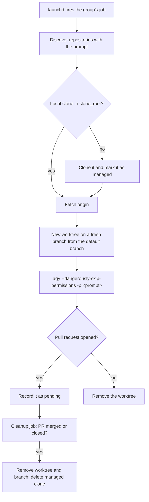

# update-deps-scheduler

Weekly, unattended dependency updates for my repositories, run locally on macOS
by [Antigravity CLI](https://antigravity.google) (`agy`) in YOLO mode.

Every non-archived, non-fork repository I own that contains
`.github/prompts/update-deps.md` gets that prompt run verbatim by `agy`, which
updates the dependencies and opens a pull request. Nothing runs in the cloud:
`launchd` starts the jobs, and `agy`, `gh`, and `git` use the credentials already
on this Mac.

## Schedule

Repositories are grouped by their GitHub primary language, so each weekday
handles one ecosystem:

| Group | Languages | When |
| --- | --- | --- |
| `r` | R | Monday 11:00 |
| `workflows` | anything not matched below (e.g. the reusable-workflows repository) | Tuesday 11:00 |
| `python` | Python | Wednesday 14:30 |
| `web` | TypeScript, JavaScript, Astro, and similar | Thursday 11:00 |

[`schedule.toml`](schedule.toml) is the source of truth. Repositories are
discovered at run time, so a repository that gains the prompt joins its group
the following week. `make list` shows the current assignment.

## How a run works



- The agent works in a separate git worktree, so an existing clone's
  checked-out branch and uncommitted work are never touched.

- A clone that did not exist before the run is deleted once its pull request
  is merged (or closed), provided it has no uncommitted changes, other
  worktrees, or unpushed commits.

- A cleanup job runs at login and every three hours.

- Repositories in a group run one after another; a lock prevents overlapping
  runs, and `caffeinate` keeps the Mac from idle-sleeping during a run.

- `launchd` runs a job missed while the Mac was asleep as soon as it wakes. A
  job missed while the Mac was shut down is skipped until the following week.

## Setup

Requires `agy` (signed in), `gh` (authenticated), `git`, and `uv`, plus each
repository's own toolchain.

```sh
make install     # write and load the launchd agents
make status      # schedule and pending pull requests
```

Run `make install` again after editing `schedule.toml`. `make uninstall`
removes the agents. Run `make help` to list every target.

> [!IMPORTANT]
> macOS privacy protection blocks launchd jobs from reading `~/Documents`,
> where the clones live. `install` compiles [`launcher.c`](launcher.c) into
> `~/Library/Application Support/update-deps/update-deps-launcher` and opens
> **System Settings › Privacy & Security › Full Disk Access**; add that binary
> there once. Only this launcher gets the permission, not `/bin/zsh`. It is
> rebuilt, and needs granting again, only when `launcher.c` changes.

Jobs run through the launcher and a login, interactive `zsh`, so they see the
same `PATH` and keychain-backed credentials as a terminal session. Nothing is
configured through environment variables.

## Manual use

```sh
make dry-run GROUP=python                  # list the group's repositories
make run GROUP=python REPO=md2linkedin     # run a single repository now
make cleanup                               # clean up after finished PRs
```

## Files outside the repository

| Path | Contents |
| --- | --- |
| `~/Library/LaunchAgents/com.indrajeetpatil.update-deps.*.plist` | Generated launchd agents |
| `~/Library/Logs/update-deps/` | Job logs, plus one agent transcript per repository and run |
| `~/Library/Application Support/update-deps/state.json` | Pending pull requests and managed clones |
| `~/Library/Application Support/update-deps/update-deps-launcher` | Compiled launcher holding the Full Disk Access grant |
| `~/Library/Caches/update-deps/worktrees/` | Worktrees for in-flight pull requests |

## Development

```sh
make check    # ruff check, ruff format --check, and ty check
make format   # apply ruff formatting
```

See [AGENTS.md](AGENTS.md) for guidance aimed at AI coding agents.
