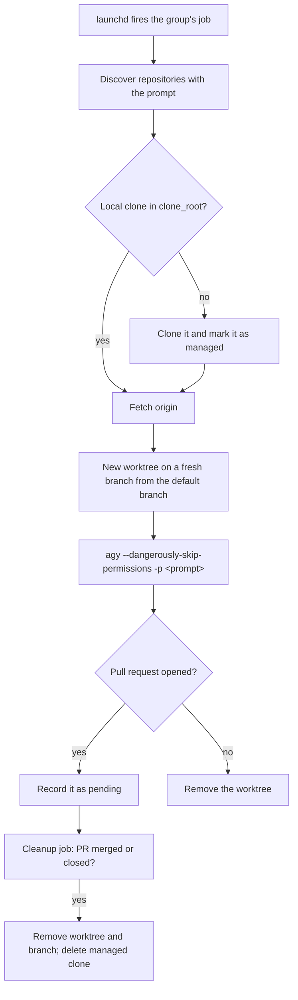

# llm-dependabot

Dependabot, but the updates are done by an LLM agent: weekly, unattended
dependency updates for my repositories, run locally on macOS by
[Antigravity CLI](https://antigravity.google) (`agy`) in YOLO mode.

Every repository that contains `.github/prompts/update-deps.md` gets that prompt
run verbatim by `agy`, which updates the dependencies and opens a pull request.
Nothing runs in the cloud: `launchd` starts the jobs, and `agy`, `gh`, and `git`
use the credentials already on this Mac.

## Schedule

Repositories are grouped by their GitHub primary language, so each weekday
handles one ecosystem:

| Group | Languages | When |
| --- | --- | --- |
| `r` | R | Monday 11:00 |
| `workflows` | anything not matched below (e.g. the reusable-workflows repository) | Tuesday 11:00 |
| `python` | Python | Wednesday 14:30 |
| `web` | TypeScript, JavaScript, Astro, and similar | Thursday 11:00 |

Repositories are discovered at run time, so a repository that gains the prompt
joins its group the following week. `make list` shows the current assignment.

## Configuration

Two YAML files sit next to the script, and every command reads both:

| File | Committed | Contents |
| --- | --- | --- |
| [`config.yaml`](config.yaml) | yes | Owner, prompt path, clone directory, timeouts, and the group schedule |
| `private.yaml` | no (git-ignored) | Private repositories to include, by name |

- Public repositories are picked up automatically: every non-archived, non-fork
  public repository owned by `owner` that contains the prompt.

- Private repositories are opt-in, so their names never reach version control.
  Copy [`private.example.yaml`](private.example.yaml) to `private.yaml` and
  list them there. Without `private.yaml`, only public repositories run.

## How a run works



- The agent works in a separate git worktree, so an existing clone's
  checked-out branch and uncommitted work are never touched.

- A clone that did not exist before the run is deleted once its pull request
  is merged (or closed), provided it has no uncommitted changes, other
  worktrees, or unpushed commits.

- A cleanup job runs at login and every three hours.

- Repositories in a group run one after another; a lock prevents overlapping
  runs, and `caffeinate` keeps the Mac from idle-sleeping during a run.

- `launchd` runs a job missed while the Mac was asleep as soon as it wakes. A
  job missed while the Mac was shut down is skipped until the following week.

## Setup

On a Mac with [Homebrew](https://brew.sh) (which also installs the Xcode
Command Line Tools, providing `git`, `make`, and `clang`):

```sh
gh repo clone IndrajeetPatil/llm-dependabot ~/Documents/GitHub/llm-dependabot
cd ~/Documents/GitHub/llm-dependabot
make setup
```

`make setup` is interactive and safe to rerun. It walks through each step,
offering to fix whatever is missing:

| Step | What happens |
| --- | --- |
| Tools | Installs `uv`, `gh`, `prek`, and Antigravity CLI with Homebrew if absent |
| Sign-ins | Runs `gh auth login` if needed and waits until `agy` is signed in |
| Owner | Offers to set `owner` in `config.yaml` to your GitHub account |
| Clone directory | Creates `clone_root` if it does not exist |
| Private repositories | Asks about each private repository that has the prompt and writes `private.yaml` |
| Git hooks | Installs the prek hooks |
| launchd | Builds the launcher, loads the agents, and waits until Full Disk Access is granted |

> [!IMPORTANT]
> macOS privacy protection blocks launchd jobs from reading `~/Documents`,
> where the clones live, even when your terminal has Full Disk Access. Setup
> compiles [`launcher.c`](launcher.c) into
> `~/Library/Application Support/update-deps/update-deps-launcher`, opens
> **System Settings › Privacy & Security › Full Disk Access**, and reveals the
> binary in Finder. Add it there and switch it on; setup confirms the grant by
> starting a throwaway launchd job. Only this launcher gets the permission, not
> `/bin/zsh`, and it needs granting again only when `launcher.c` changes.

Agents work inside each repository, so its own toolchain (R, Python, Node.js,
and so on) must also be installed for the agent to run its checks.

Run `make install` after editing `config.yaml` or `private.yaml`; it refuses
to reload while a job is running, since that would stop it. `make status`
shows the schedule and pending pull requests, `make uninstall` removes the
agents, and `make help` lists every target.

Jobs run through the launcher and a login, interactive `zsh`, so they see the
same `PATH` and keychain-backed credentials as a terminal session. Nothing is
configured through environment variables.

## Manual use

```sh
make dry-run GROUP=python                  # list the group's repositories
make run GROUP=python REPO=my-project      # run a single repository now
make cleanup                               # clean up after finished PRs
```

## Files outside the repository

| Path | Contents |
| --- | --- |
| `~/Library/LaunchAgents/com.indrajeetpatil.update-deps.*.plist` | Generated launchd agents |
| `~/Library/Logs/update-deps/` | Job logs, plus one agent transcript per repository and run |
| `~/Library/Application Support/update-deps/state.json` | Pending pull requests and managed clones |
| `~/Library/Application Support/update-deps/update-deps-launcher` | Compiled launcher holding the Full Disk Access grant |
| `~/Library/Caches/update-deps/worktrees/` | Worktrees for in-flight pull requests |

## Development

```sh
make hooks-install   # once per clone: install the prek git hooks
make check           # ruff check, ruff format --check, and ty check
make format          # apply ruff formatting
make hooks           # run every prek hook on all files
```

The [prek](https://prek.j178.dev) hooks in [`prek.toml`](prek.toml) run Ruff
and ty, tidy whitespace, and block committed private keys, large files, and
merge-conflict markers. A local hook also fails any commit whose files or
message name a repository listed in `private.yaml`, or that adds
`private.yaml` itself.

See [AGENTS.md](AGENTS.md) for guidance aimed at AI coding agents.
