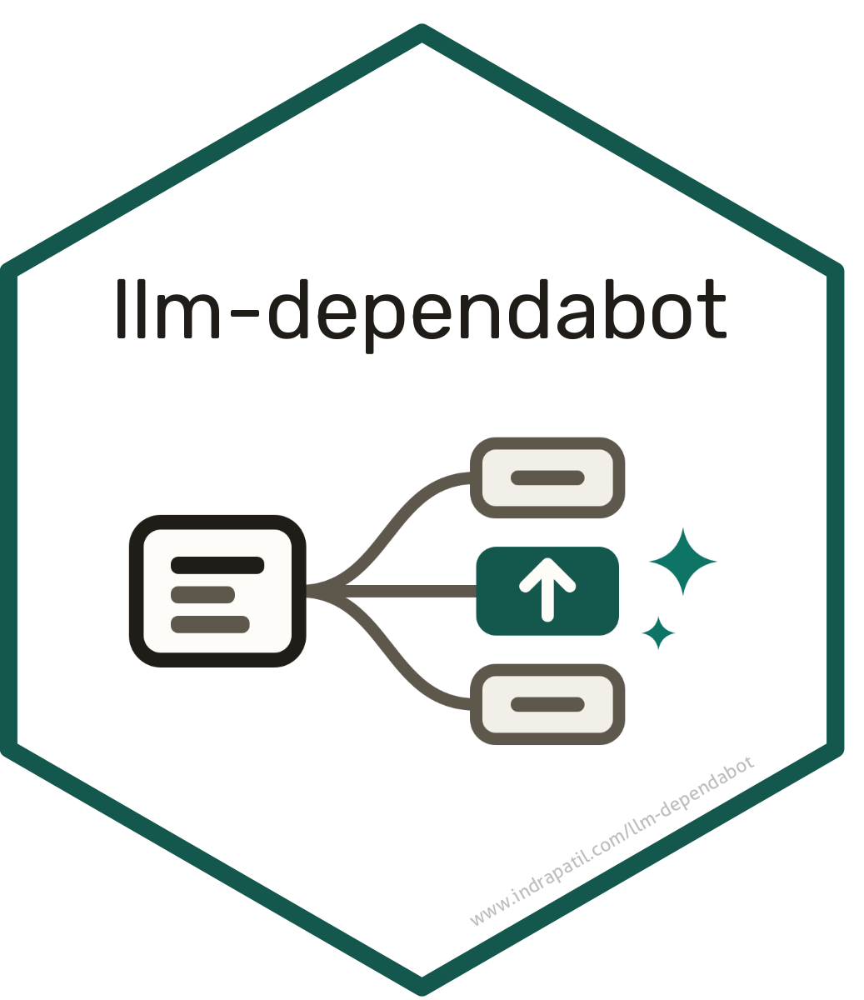

# llm-dependabot 

Dependabot, but a coding agent does the work.

llm-dependabot runs the prompts that your repositories commit (dependency
updates, refactoring, codebase simplification, or anything else) with a
coding agent on a schedule, and the agent opens a pull request for you to
review. Because each project's own prompt, conventions, and checks guide the
agent, it can fix the breakage an upgrade causes and batch related changes
into one reviewable pull request.

- **Opt in per repository and prompt:** a repository takes part in each
  prompt it commits, such as `.github/prompts/update-deps.md` or
  `.github/prompts/simplify-codebase.md`, and the prompt runs verbatim.

- **Any coding agent:** the agent and how it is called are configuration, so
  any agent with a non-interactive mode works: Antigravity CLI, Claude Code,
  Codex CLI, GitHub Copilot CLI, and so on.

- **A staggered schedule:** repositories are grouped by ecosystem, each group
  runs on its own weekday, and each prompt runs weekly or monthly.

- **Isolated and tidy:** every prompt runs in its own git worktree and branch,
  and clones made just for a run are deleted once their pull request is
  merged or closed.

- **Your machine, your credentials:** the agent, `gh`, and `git` use the
  sign-ins you already have; there is no hosted service and no stored secret.


## Quick start

> [!NOTE]
> llm-dependabot runs on macOS, where `launchd` schedules the runs, and
> installs its tools with [Homebrew](https://brew.sh).

```sh
gh repo clone IndrajeetPatil/llm-dependabot ~/Documents/GitHub/llm-dependabot
cd ~/Documents/GitHub/llm-dependabot
make setup
```

`make setup` interactively installs what is missing, signs you in to GitHub
and your coding agent, asks which private repositories to include, and loads
the schedule. See [Setup](https://www.indrapatil.com/llm-dependabot/setup/)
for the details.

## Documentation

The full documentation is at <https://www.indrapatil.com/llm-dependabot/>.

| Guide | Covers |
| --- | --- |
| [Setup](https://www.indrapatil.com/llm-dependabot/setup/) | Requirements, `make setup`, Full Disk Access, and uninstalling |
| [Configuration](https://www.indrapatil.com/llm-dependabot/configuration/) | The coding agent, prompts and their cadences, and the schedule |
| [Usage](https://www.indrapatil.com/llm-dependabot/usage/) | Everyday commands, logs, files on disk, and troubleshooting |
| [Architecture](https://www.indrapatil.com/llm-dependabot/architecture/) | How a run works and why it is built this way |
| [Development](https://www.indrapatil.com/llm-dependabot/development/) | Toolchain, checks, CI, and the documentation site |
| [LLMs](https://www.indrapatil.com/llm-dependabot/integrations/llms/) | The documentation in the `llms.txt` format |

## License

[MIT](https://github.com/IndrajeetPatil/llm-dependabot/blob/main/LICENSE)
