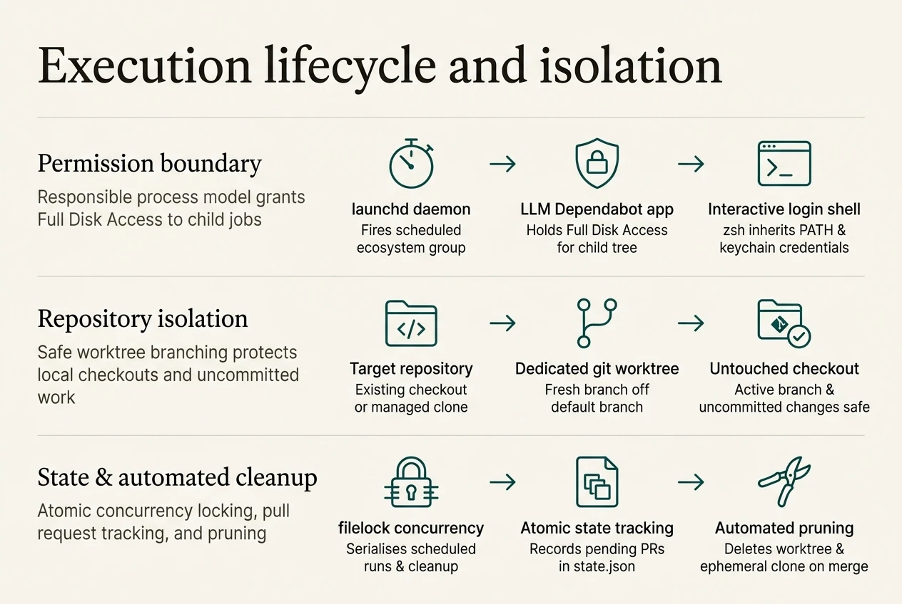

# Architecture

llm-dependabot is a scheduler, not an agent. It decides when and where the
agent runs, isolates its work, and cleans up afterwards. The intelligence lives
in each repository's own prompt.

## Components

| Component | Role |
| --- | --- |
| [`llm_dependabot.py`](../llm_dependabot.py) | The CLI: a single-file uv script that discovers repositories, runs the agent, tracks pull requests, and writes the launchd agents |
| [`config.yaml`](../config.yaml) and `private.yaml` | The schedule and which repositories take part (see [Configuration](configuration.md)) |
| [`app/`](../app) | Sources of the LLM Dependabot app, a tiny launcher that holds the Full Disk Access grant |
| launchd | macOS's built-in scheduler: one agent per group, plus a cleanup agent |
| `agy` | Antigravity CLI, which runs the prompt and opens the pull request |
| `gh` and `git` | Discovery, cloning, worktrees, and pull request state |

The script leans on widely used libraries rather than code of its own:
[Typer](https://typer.tiangolo.com) for the command line and prompts,
[pydantic](https://docs.pydantic.dev) (with its Rust core) to validate the
configuration and state, [PyYAML](https://pyyaml.org) to read the YAML, and
[filelock](https://py-filelock.readthedocs.io) to serialise runs.

## Process tree

- **The app** starts the job as a child process rather than replacing itself,
  so macOS treats it as the "responsible process" and applies its Full Disk
  Access grant to everything below it.

- **A login, interactive zsh** gives the job the same `PATH` and
  keychain-backed credentials as a terminal session, so nothing is configured
  through environment variables.

## A run

- **Discovery** lists the owner's repositories with `gh` and checks each for
  the prompt through the GitHub API, so repositories need not be cloned
  first.

- **Isolation:** the agent works in a separate git worktree, so an existing
  clone's checked-out branch and uncommitted work are never touched.

- **Pull request detection** looks for a pull request from the run's branch,
  falling back to one opened by you since the run started, in case the agent
  chose its own branch name.

- **Repositories run one after another.** A failure in one is logged and the
  run moves on.

- **A timeout** bounds each agent run, backed by a hard stop in case the CLI's
  own timeout does not fire.

## Cleanup

A clone that did not exist before the run is deleted once its pull request is
merged or closed. It is kept, and retried at the next cleanup, if it has
uncommitted changes, other worktrees, or unpushed commits.

## State

`state.json` records pending pull requests (with their worktree and branch)
and the clones llm-dependabot created. It is written atomically, and a lock
keeps a scheduled run and a cleanup from changing it at the same time.
