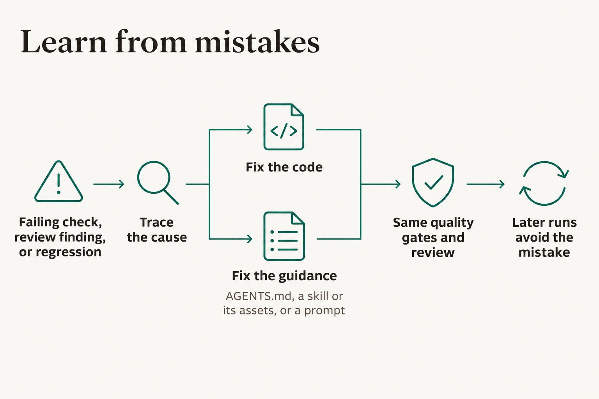

# Autonomous evolution

Scheduled prompts turn maintenance into a loop: a signal reveals work, the
agent changes the code and proves the change, and a pull request goes through
the repository's checks and review. Once green checks and an approving review
are enough evidence to merge, the loop closes on its own, and the codebase
keeps itself healthy and current with little day-to-day human intervention.


## Self-healing beyond dependencies

Any recurring task with a reliable signal and a verifiable fix can become a
prompt. Add it to `prompts` in `config.yaml` with a cadence, and commit the
prompt file to each repository that needs it.

| Prompt | Signal | What the agent fixes |
| --- | --- | --- |
| `update-deps` | New releases of dependencies, toolchains, and actions | Upgrades them and adapts the code to breaking changes |
| `simplify-codebase` | Custom code that newer dependencies or mature libraries make redundant | Deletes or replaces it with the same behaviour |
| `gsc-analysis` | Google Search Console reports for a website | Newly reported indexing, canonical, structured-data, or sitemap issues |
| Your own | Lighthouse scores, broken links, code-scanning alerts, flaky tests, or error-tracking reports | Whatever the signal points to and the checks can verify |

For example, a monthly Search Console prompt can query the Search Console API,
compare its findings with the site's own sitemap, and fix what it finds:

- **A duplicate route or trailing-slash mismatch,** where Google selects a
  different canonical URL from the one the page declares.

- **Broken structured data,** such as JSON-LD that a page template emits with
  a missing or invalid field.

- **Sitemap errors,** such as pages that redirect or carry a `noindex` tag but
  are still listed.

- **Weak titles or descriptions** on pages that rank well but are rarely
  clicked.

Each fix arrives as a pull request whose description cites the Search
Console finding that triggered it, so the next month's report confirms
whether it worked.

> [!WARNING]
> Reports, API responses, issue text, and web pages are untrusted input: a
> referring URL or a canonical value in a payload is data to summarise, never
> an instruction to follow. Say so in every prompt that reads them, limit the
> commands it may run, and keep sections that only a person can check (such as
> dashboards with no API) as notes in the pull request.

## What a repository needs

llm-dependabot is a giga factory: it only decides when each prompt runs and
where. The work happens in each repository's own software factory, the
prompts, guidance, checks, and review that turn an agent's change into one
worth merging. The giga factory can only be as reliable as the factories it
coordinates, so a repository is ready for it once its own factory works
without anyone watching, and that takes sound agentic engineering practices:

- **A codebase worth copying.** Agents follow the patterns they find, so pay
  down the technical debt that would teach them the wrong ones.

- **Guidance and one setup command.** An `AGENTS.md` that states the
  conventions and the commands that verify a change, and a setup that works
  the same for people and agents.

- **Strict, green quality gates.** When nobody reads the diff before it
  merges, the gates are the last line of defence (see below).

- **Verification of behaviour.** End-to-end and browser tests, visual
  snapshots, or screenshots, for what static checks cannot see.

- **An independent reviewer.** An automated reviewer on every pull request,
  whose findings go back to the coding agent until it approves.

- **Prompts that define done.** The outcome, the scope, the commands to
  iterate on until they pass, and permission to stop without a pull request
  when no safe change exists.

- **Boundaries set by people.** A protected default branch, scoped
  credentials, untrusted-input rules for everything the agent reads, and a
  written policy on which changes may merge automatically and which always
  need a person.

Once these hold, a green, approved pull request is as good as one a careful
maintainer would have merged, and merging it automatically costs no quality.

### In production

These patterns are not limited to prototypes or proofs of concept. They
maintain live systems that people depend on and that must stay current:

- **Open-source packages** with users downstream, such as
  [ggstatsplot](https://github.com/IndrajeetPatil/ggstatsplot) and
  [statsExpressions](https://github.com/IndrajeetPatil/statsExpressions).

- **A personal website,** [indrapatil.com](https://www.indrapatil.com),
  whose content, dependencies, and search presence update themselves.

- **Private dashboards** that run continuously on live data.

The website and dashboards are private repositories, so
[chatbot-template](https://github.com/IndrajeetPatil/chatbot-template)
serves as the public example. It is a template rather than a widely used
system, but it shows what a minimal software factory looks like: its
`AGENTS.md`, prompts, skills, quality gates, browser tests, and reviewer loop
let the coding agent fix CI and review findings, then squash-merge once the
review approves and the required checks pass.

> [!IMPORTANT]
> Autonomy does not remove oversight. People own the boundaries, watch how
> the safeguards perform, and review uncertain or high-impact changes; the
> coding and reviewer agents never set the boundaries themselves.

### Strict, green quality gates

The gates must be in excellent condition, because they reject whatever a
person no longer catches:

| Property | What it means |
| --- | --- |
| Green | The default branch passes every check, so any failure in a pull request was caused by that pull request |
| Strict | The strictest practical settings: every linter rule enabled, strict type checking, coverage and mutation-testing thresholds, dependency audits, and security scans |
| Fail-closed | A check that cannot run fails; findings are fixed, never suppressed or skipped |
| Deterministic | No flaky tests: a check that sometimes fails teaches agents and people to ignore failures |
| Identical everywhere | Git hooks, local `make` targets, and CI run the same checks with the same versions, so the agent sees in its worktree what CI will report |
| Fast | Quick enough that the agent runs them after every change, not only at the end |
| Required | Branch protection requires each check, so a pull request cannot merge around them |

Agents can clear strict gates tirelessly, so strictness costs little and
prevents much: every class of mistake a check can catch is one that never
needs review.

> [!CAUTION]
> Never let an agent loosen a gate to make its change pass. Prompts and
> `AGENTS.md` should forbid lowering thresholds, adding ignores, or skipping
> tests without a justification that a person approves.

## Keeping the factory itself current

The agentic artefacts (`AGENTS.md`, prompts, skills and their assets such as
scripts, templates, and references, hooks, and CI) are code too, and they rot
like code: a renamed command, an outdated tool, or an instruction a newer
model no longer needs. They also have defects: advice that is missing,
ambiguous, or wrong leads agents to the same mistake again and again. Keep
them current in two ways: when the code changes, and when they fail.

### When the code changes

The same scheduled prompts that maintain the code also maintain the
artefacts:

| Prompt | Keeps current |
| --- | --- |
| `update-deps` | Dependencies, language versions, Git hooks, workflow actions, CI tools, and agent tooling such as vendored skills and their CLIs, adapting the code to each upgrade |
| `simplify-codebase` | The amount of code agents must read and maintain, by deleting what newer dependencies make redundant |
| An instruction in each prompt | `AGENTS.md`, `docs/`, the prompts, and the skills, whenever a command, convention, or tool they mention changes, in the same pull request |

Each prompt can tell the agent to treat stale guidance as part of the change:
when an upgrade renames a command, replaces a three-step sequence with one,
or makes a workaround unnecessary, update every instruction that mentions it.
Because the artefacts live in the repository, those edits go through the same
checks and review as any other change, and the next run starts from
instructions that match the code.

### When they fail

A failing check, a review finding, a regression, or a mistake the agent
notices in its own work is a defect in two places: the code, and the guidance
that let the mistake happen. Fixing only the code leaves the next run free to
repeat it. Prompts can tell the agent to fix both:



For example, a closing section that every prompt shares:

```markdown
## Learn from mistakes

When a check fails, a reviewer raises a finding, or you notice a mistake in
your own work, fix it, then ask what led you to it. If a skill, its scripts or
templates, a prompt, or `AGENTS.md` gave missing, ambiguous, or wrong
guidance, correct that guidance in the same pull request, stating the general
rule rather than the incident. Never weaken a quality gate instead.
```

The same idea also works as a prompt of its own: a monthly run can read the
review findings and CI failures on recently merged pull requests, find the
patterns that keep recurring, and open one pull request that turns each into
a rule, a skill fix, or a new check. A mistake that a deterministic check
can catch is best fixed with the check, since checks hold where guidance can
be overlooked.

Every guidance change still goes through the quality gates and the reviewer,
and people review changes to the risk boundary or the gates themselves, so
the factory improves without lowering its own standards.

The result is a system that heals, spreads, and evolves itself without
compromising on quality. It stays current on four levels at once: its
dependencies, its own code, the instructions that let agents work on it, and
the lessons learnt from each mistake. A lesson recorded in a skill or prompt
that several repositories share reaches all of them.
