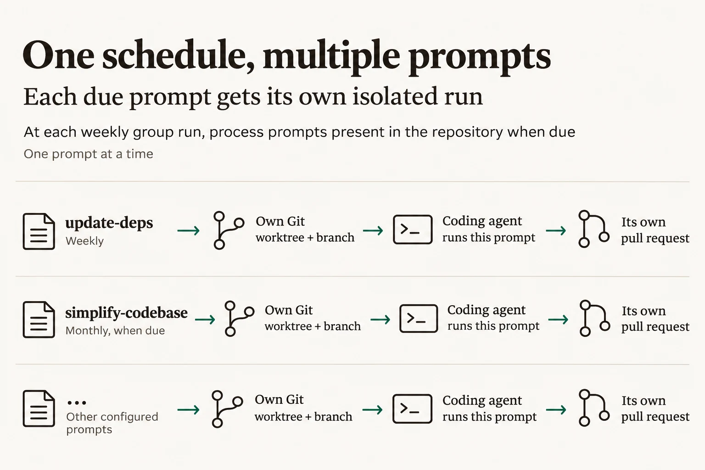

# Configuration

Two YAML files sit at the root of the repository, and every command reads both. Both are
validated strictly on load: unknown keys are rejected and values are never
converted between types, so a typo fails with a clear message instead of a
silent misconfiguration. Quote times (`"11:00"`): YAML reads an unquoted
`9:00` as the number 540, which fails validation.

| File | Committed | Contents |
| --- | --- | --- |
| [`config.yaml`](https://github.com/IndrajeetPatil/llm-dependabot/blob/main/config.yaml) | yes | Owner, prompts and their cadences, clone directory, coding agent, timeouts, and the schedule |
| `private.yaml` | no (git-ignored) | Private repositories to include, by name |

Run `make install` after editing either file.

## `config.yaml`

| Key | Meaning |
| --- | --- |
| `owner` | GitHub account whose repositories are considered |
| `prompts` | The prompts repositories can opt into, and how often each runs (see below) |
| `clone_root` | Where existing clones are found and missing ones are cloned |
| `agent` | The coding agent and how to call it (see below) |
| `agent_timeout_hours` | Upper bound for one repository's agent run |
| `cleanup_interval_hours` | How often finished pull requests are cleaned up |
| `skip_weekends` | Whether scheduled jobs do nothing on Saturdays and Sundays (default `true`) |
| `label` | The label (`name`, six-digit hex `color`, and `description`) added to every pull request a run opens, within a few minutes of the agent opening it, and created in each repository as needed; omit it to leave pull requests unlabelled |
| `groups` | The schedule (see below) |

## The coding agent

The agent runs once per repository and prompt, unattended, inside a fresh
worktree. Any agent with a non-interactive mode works; the shipped
`config.yaml` uses Antigravity CLI:

```yaml
agent:
  name: Antigravity CLI
  command:
    - agy
    - --dangerously-skip-permissions
    - --print-timeout
    - "{timeout_hours}h"
    - -p
    - "{prompt}"
  check: [agy, models]
```

| Key | Meaning |
| --- | --- |
| `name` | Shown by `make setup` |
| `command` | The command line, one argument per item. An argument that is exactly `"{prompt}"` becomes the prompt's text; without one, the prompt goes to standard input. `{timeout_hours}` becomes `agent_timeout_hours`. |
| `check` | Optional: a command that succeeds once the agent is installed and signed in. `make setup` waits for it. |

> [!WARNING]
> Nobody is there to approve the agent's actions, so it must be able to edit
> files, run commands, and push without asking. Give it the same trust you
> give your own terminal session.

Each agent takes the same shape:

| Agent | `command` | `check` |
| --- | --- | --- |
| Antigravity CLI | `[agy, --dangerously-skip-permissions, --print-timeout, "{timeout_hours}h", -p, "{prompt}"]` | `[agy, models]` |
| Claude Code | `[claude, --dangerously-skip-permissions, -p, "{prompt}"]` | `[claude, auth, status]` |
| Codex CLI | `[codex, exec, --dangerously-bypass-approvals-and-sandbox, "{prompt}"]` | `[codex, login, status]` |
| GitHub Copilot CLI | `[copilot, --yolo, -p, "{prompt}"]` | — |

> [!TIP]
> Check the flags against your agent's version; they change between releases.

When switching agents, also replace `antigravity-cli` in the
[`Brewfile`](https://github.com/IndrajeetPatil/llm-dependabot/blob/main/Brewfile) with your agent's package. A run that outlasts
`agent_timeout_hours` by ten minutes is stopped, so agents without a timeout
of their own are bounded too.

## Prompts and cadence

Each prompt is a file that repositories opt into by committing it at `path`.
It runs verbatim, in its own worktree and branch (`chore/<name>-<timestamp>`),
so each prompt opens its own pull request.

```yaml
prompts:
  - name: update-deps
    path: .github/prompts/update-deps.md
    cadence: weekly

  - name: simplify-codebase
    path: .github/prompts/simplify-codebase.md
    cadence: monthly

  - name: gsc-analysis
    path: .github/prompts/gsc-analysis.md
    cadence: monthly
```

| Key | Meaning |
| --- | --- |
| `name` | Identifies the prompt in `cadence` overrides, branch names, logs, and `make run PROMPT=…`; letters, digits, `.`, `_`, and `-` only |
| `path` | Path of the prompt inside each repository |
| `cadence` | `weekly` (the default) or `monthly`; a group can override it |

- **Weekly** prompts run at every scheduled run of the repository's group.

- **Monthly** prompts run at the group's first scheduled run in each calendar
  month. `state.json` records when each prompt last ran in each repository,
  so a monthly prompt whose run was missed, skipped, or failed runs at the
  group's next scheduled run instead of waiting a month.



## Groups and the schedule

Each group runs at a local wall-clock time on one weekday, and may override a
prompt's cadence:

```yaml
groups:
  - name: r
    languages: [R]
    weekday: Thursday
    time: "11:00"
    cadence:
      update-deps: monthly
```

A repository joins the first group whose `languages` include its GitHub
primary language. The group with `languages: ["*"]` takes everything else.
The default schedule, with nothing on Fridays or at weekends:

| Group | Languages | Day | `update-deps` | `simplify-codebase` and `gsc-analysis` |
| --- | --- | --- | --- | --- |
| `web` | TypeScript, JavaScript, Astro, Svelte, Vue, HTML, and CSS | Monday 11:00 | weekly | first Monday of the month |
| `python` | Python | Tuesday 11:00 | weekly | first Tuesday of the month |
| `workflows` | anything not matched by another group | Wednesday 11:00 | weekly | first Wednesday of the month |
| `r` | R | Thursday 11:00 | first Thursday of the month | first Thursday of the month |


With `skip_weekends: true`, groups cannot be scheduled on a Saturday or
Sunday, and a scheduled job that launchd starts late at a weekend (for
example, after the Mac wakes) does nothing. Weekly prompts then wait for the
following week, and monthly ones for the group's next scheduled run.

## Which repositories take part

- **Public:** every non-archived, non-fork public repository owned by `owner`
  that contains at least one of the prompts, found automatically at run time.

- **Private:** only those listed in `private.yaml`, so their names never reach
  version control. Each still needs at least one of the prompts.

A repository runs only the prompts it contains. One that gains a prompt picks
it up at its group's next scheduled run that finds the prompt due.
`make list` shows the current assignment. See
[Prepare your repositories](setup.md#5-prepare-your-repositories) for
guidance on committing prompts and onboarding projects.

## `private.yaml`

`make setup` writes it for you. To edit it by hand, copy
[`private.example.yaml`](https://github.com/IndrajeetPatil/llm-dependabot/blob/main/private.example.yaml):

```yaml
repos:
  - my-private-app
  - another-private-tool
```

Without `private.yaml`, only public repositories run. A git hook rejects any
commit that adds this file or names one of its repositories.

## Forking and adapting

llm-dependabot is designed as a template: create a new repository from it or
fork it, and adapt the configuration for your own projects.

| To change | Edit |
| --- | --- |
| Whose repositories take part | `owner` in `config.yaml` (`make setup` offers to set it), and `private.yaml` |
| Which prompts run, and how often | `prompts`, and per-group `cadence`, in `config.yaml` |
| The schedule | `groups` in `config.yaml` |
| The coding agent | `agent` in `config.yaml`, and its package in the `Brewfile` |
| Where clones live | `clone_root` in `config.yaml` |

> [!IMPORTANT]
> The agent can only be as good as what each repository gives it: a
> committed prompt for each kind of maintenance, guidance such as an
> `AGENTS.md`, and checks (tests, linters, and CI) that it can run to verify
> its changes. A repository without a prompt is never touched.
> The giga factory is only as reliable as each repository's own software
> factory; see [what a repository needs](autonomy.md#what-a-repository-needs).

See [Setup](setup.md) for the end-to-end walkthrough on initialising the
repository, configuring your coding agent and clone directory, running
interactive setup, and testing your installation.

### What comes with the template

The scheduler needs only `src/`, `pyproject.toml` and `uv.lock`,
`config.yaml`, `private.example.yaml`, `app/`, `hooks/`, `prek.toml`, the
`Makefile`, and the `Brewfile`. The rest serves this repository's own
documentation, branding, and CI:

| Files | In your copy |
| --- | --- |
| `.github/workflows/` | Self-contained CI that runs in any account; `docs.yml` deploys the site from `main`, so set **Settings › Pages › Source** to **GitHub Actions** or delete it |
| `docs/`, `mkdocs.yml`, and `overrides/` | The documentation site; `mkdocs.yml` sets this site's URL and Google Analytics property, and `overrides/main.html` names its author. Change them before deploying the site, or delete them with `docs.yml` and the `docs` targets in the `Makefile` |
| `.github/prompts/` | This repository's own maintenance prompts; keep them so llm-dependabot maintains your copy. Their smoke test runs `make dry-run GROUP=python`, so update it if you rename or remove the `python` group |
| `AGENTS.md` | Guidance for agents working on your copy, including the pull-request workflow (wait for CI and an automatic Codex review, then squash-merge); adapt the review and merge rules to your own process |
| `pyproject.toml` and `LICENSE` | The package's author, URLs, and copyright; replace them with your own |
| `hextools/`, `DESIGN.md`, and `.agents/` | Branding and figure generation; delete them, or keep them to draw your own |

`app/icon.png` is the app's icon; replacing it rebuilds the app, which needs
Full Disk Access granted again.

`BUNDLE_ID` in `src/llm_dependabot/paths.py` names the app and prefixes the
launchd agents (`com.indrajeetpatil.llm-dependabot.*`). Keeping it is
harmless. To use your own, run `make uninstall` first, since the CLI finds
installed agents by this prefix, then change it, run `make install`, and
grant the rebuilt app Full Disk Access again.

### Another operating system

The scheduling and the tooling are macOS's. Everything else (discovery,
worktrees, running the agent, pull-request tracking, and cleanup) is plain
`git`, `gh`, and Python. To run elsewhere, replace these parts of the
`llm_dependabot` package, which keeps them in `paths.py` (the `~/Library`
locations of logs, state, worktrees, and the agents), `launchd.py`,
`install.py`, `macos_app.py`, `runner.py`, and `shell.py`:

| macOS part | Role | Replace with, for example |
| --- | --- | --- |
| `launchd` agents (`launchctl`) | Start each group's run and the cleanup on schedule | systemd timers or cron on Linux, Task Scheduler on Windows |
| The LLM Dependabot app (`app/`) | Holds the Full Disk Access grant | Nothing, where the OS has no such protection |
| `caffeinate` | Keeps the machine awake during a run | `systemd-inhibit` on Linux |
| `osascript` notifications | Summarise each run | `notify-send` on Linux, or nothing |
| Homebrew and the `Brewfile` | Install the tools | The system's package manager |
