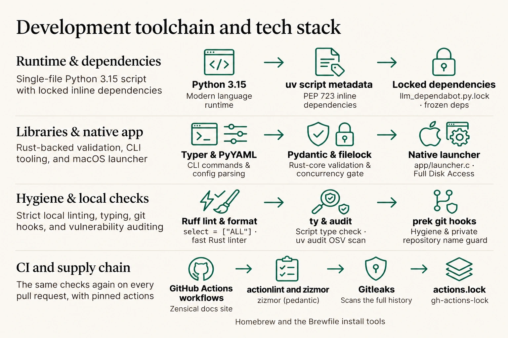

# Development

## Toolchain



- **Python 3.15** in a single-file [uv](https://docs.astral.sh/uv/) script
  with inline dependencies, locked in `llm_dependabot.py.lock`; there is no
  virtual environment to manage.

- **[Ruff](https://docs.astral.sh/ruff/)** lints (with every rule enabled)
  and formats.

- **[ty](https://docs.astral.sh/ty/)** type-checks against the script's own
  environment.

- **[prek](https://prek.j178.dev)** runs the git hooks.

- **`uv audit`** checks the locked dependencies of both scripts against the
  OSV vulnerability database.

- **[Homebrew](https://brew.sh)** installs the command-line tools listed in
  the [`Brewfile`](../Brewfile).

There is no CI by design: everything runs locally.

## Checks

```sh
make hooks-install   # once per clone: install the git hooks
make check           # ruff check, ruff format --check, ty check, and audit
make audit           # check locked dependencies for known vulnerabilities
make format          # apply ruff formatting
make hooks           # run every prek hook on all files
make update-deps     # upgrade locked dependencies and prek hook revisions
```

The hooks in [`prek.toml`](../prek.toml) run Ruff and ty, tidy whitespace, and
block private keys, large files, and merge-conflict markers. A local hook,
[`hooks/check_private_names.py`](../hooks/check_private_names.py), fails any
commit whose files or message name a repository listed in `private.yaml`, or
that adds `private.yaml` itself.

## Dependency updates

This repository has its own
[`update-deps` prompt](../.github/prompts/update-deps.md), so llm-dependabot
keeps itself up to date like any other participating repository.

## Design

[`DESIGN.md`](../DESIGN.md) records the visual identity, shared with
indrapatil.com. Generated documentation figures follow the
[documentation-illustrations skill](../.agents/skills/documentation-illustrations/SKILL.md),
with their prompts recorded in [images/README.md](images/README.md).

## Hex sticker and app icon

[`hextools/`](../hextools) holds the sticker artwork and the R script that
renders both `docs/images/logo.png` and the LLM Dependabot app icon,
`app/icon.png`. See [its README](../hextools/README.md).
