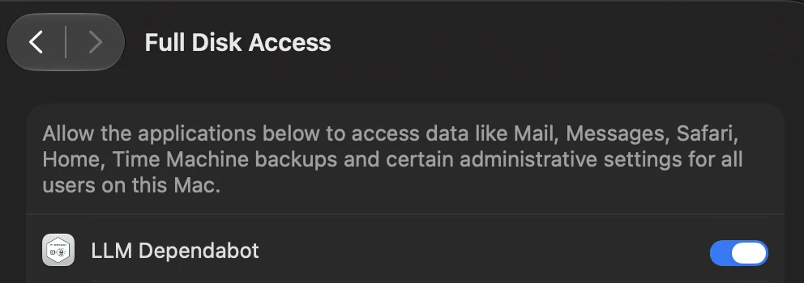

# Setup

> [!NOTE]
> llm-dependabot runs on macOS: `launchd` schedules the runs, and a small app
> holds the permission they need to read your clones.

## Requirements

- [Homebrew](https://brew.sh), which also installs the Xcode Command Line
  Tools (`git`, `make`, and `clang`).

- A GitHub account that owns the repositories.

- A coding agent with a non-interactive mode, and an account for it (see
  [The coding agent](configuration.md#the-coding-agent)).

- Each participating repository's own toolchain (R, Python, Node.js, and so
  on), so the agent can run its checks.

`make setup` installs everything else from the [`Brewfile`](https://github.com/IndrajeetPatil/llm-dependabot/blob/main/Brewfile):
`uv`, `gh`, `prek`, and the coding agent named there.

## Run the setup

```sh
gh repo fork IndrajeetPatil/llm-dependabot --clone
cd llm-dependabot
make setup
```

Setup is interactive and safe to rerun. It walks through each step and offers
to fix whatever is missing:

| Step | What happens |
| --- | --- |
| Tools | Installs missing [`Brewfile`](https://github.com/IndrajeetPatil/llm-dependabot/blob/main/Brewfile) packages with `brew bundle` |
| Sign-ins | Runs `gh auth login` if needed and waits until the agent's `check` command succeeds |
| Owner | Offers to set `owner` in `config.yaml` to your GitHub account |
| Clone directory | Creates `clone_root` if it does not exist |
| Private repositories | Asks about each private repository that has a configured prompt and writes `private.yaml` |
| Git hooks | Installs the prek hooks |
| App and agents | Builds the LLM Dependabot app, loads the launchd agents, and waits until the app can read your clones |

## Full Disk Access

macOS privacy protection blocks launchd jobs from reading `~/Documents`, where
the clones live, even when your terminal has Full Disk Access. The jobs
therefore start through a tiny app, **LLM Dependabot**, which setup builds
into `~/Library/Application Support/llm-dependabot/`.

Setup opens **System Settings › Privacy & Security › Full Disk Access** and
reveals the app in Finder. If LLM Dependabot is already listed, switch it on;
otherwise drag it into the list (or click **+** and choose it) first. Setup
then confirms the grant by starting a throwaway launchd job and continues once
that job can read your clones.



macOS may already list the app, switched off: it adds any program that tries
to read protected data, which the app does the first time a job runs.

> [!NOTE]
> Only the LLM Dependabot app gets the permission, not `/bin/zsh`. It needs
> granting again only when its sources (`app/`) change, since macOS ties the
> grant to the app's code signature.

## After editing the configuration

Run `make install` after changing `config.yaml` or `private.yaml`. It refuses
to reload while a job is running, since unloading would stop it.

## Uninstall

```sh
make uninstall
```

This removes the launchd agents. To remove everything, also delete the folders
listed under [Files on disk](usage.md#files-on-disk) and remove LLM
Dependabot from the Full Disk Access list.
