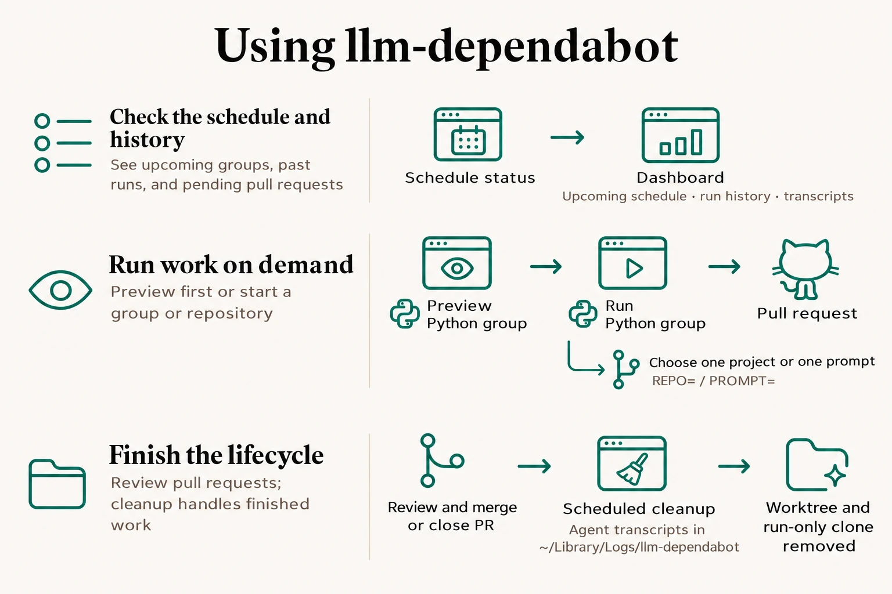

# Usage

Once set up, nothing needs doing: each group runs on its weekday, and pull
requests appear in the repositories. Review and merge them as usual; clones
made for a run are deleted after their pull request is merged.



## Commands

`make help` lists every target. The everyday ones:

| Command | Does |
| --- | --- |
| `make status` | Show the schedule and pending pull requests |
| `make list` | Show which repositories fall into which group |
| `make dry-run GROUP=python` | List a group's repositories without running anything |
| `make run GROUP=python` | Run a whole group now |
| `make run GROUP=python REPO=my-project` | Run one repository now |
| `make cleanup` | Clean up after merged or closed pull requests now |
| `make install` | Reload the agents after editing the configuration |

Each target wraps `./llm_dependabot.py`, which also works directly
(`./llm_dependabot.py --help`).

## When jobs run

- A job missed while the Mac was asleep runs as soon as it wakes.

- A job missed while the Mac was shut down is skipped until the following
  week; use `make run` to catch up.

- `caffeinate` keeps the Mac from idle-sleeping during a run, and a lock stops
  runs from overlapping.

- A cleanup job runs at login and every `cleanup_interval_hours`.

- A notification summarises each run when it finishes.

## Watching a run

In Activity Monitor, choose **View › All Processes, Hierarchically** and search
for the agent's process (`antigravity` for the default agent). A run looks
like this:

```text
LLM Dependabot
└─ zsh
   └─ uv
      └─ python        llm_dependabot.py run GROUP
         ├─ caffeinate keeps the Mac awake during the run
         └─ the agent  antigravity by default
            └─ git, gh, uv, pnpm, Rscript, …  tools the agent runs
```

The agent's CPU and memory use rise and fall as it edits files and runs each
repository's checks. Quitting LLM Dependabot, the top process, stops the
whole run. Each agent's own output is written to its transcript under
`~/Library/Logs/llm-dependabot/` when it finishes.

## Files on disk

| Path | Contents |
| --- | --- |
| `~/Library/LaunchAgents/com.indrajeetpatil.llm-dependabot.*.plist` | Generated launchd agents |
| `~/Library/Logs/llm-dependabot/` | One log per group, plus one agent transcript per repository and run |
| `~/Library/Application Support/llm-dependabot/state.json` | Pending pull requests and clones to delete later |
| `~/Library/Application Support/llm-dependabot/LLM Dependabot.app` | App holding the Full Disk Access grant |
| `~/Library/Caches/llm-dependabot/worktrees/` | Worktrees for in-flight pull requests |

## Troubleshooting

| Symptom | Fix |
| --- | --- |
| A job's log shows `Operation not permitted` | Grant LLM Dependabot Full Disk Access again; `make install` checks it |
| A repository is missing from `make list` | Check the prompt is on its default branch and, if private, that `private.yaml` lists it |
| A run opened no pull request | Read the agent transcript under `~/Library/Logs/llm-dependabot/` |
| `make install` says a job is running | Wait until it finishes; `make status` shows the schedule |
